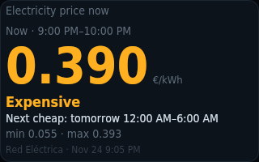
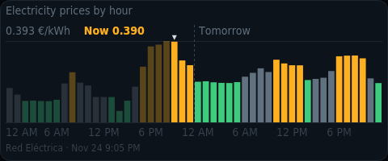
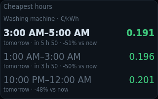

# kiosko-plugin-electricity

The electricity price by the hour on the panel: the price now, green, grey or amber against the rest of the day, the day's bars with tomorrow's once published, and the cheapest hours to run the washing machine. Today for Spain's regulated tariff (PVPC), from Red Eléctrica, no key needed.

A plugin for [Kiosko](https://github.com/kiosko-lcd/kiosko), the widget mosaic for small USB LCD panels.



## Install

In Kiosko, **Plugins → Install from npm** → `kiosko-plugin-electricity`, then restart Kiosko. Or from a terminal:

```sh
npm install --prefix ~/.config/kiosko/plugins kiosko-plugin-electricity
```

(macOS: `~/Library/Application Support/Kiosko/plugins`, Windows: `%APPDATA%\Kiosko\plugins`.)

## Requirements

- Today one provider: Spain's PVPC. Internet access to `apidatos.ree.es` (Red Eléctrica's public REData API, no key). Optionally a free ESIOS token, as a fallback.
- The PVPC is Spain's 2.0TD regulated tariff (most homes on the regulated rate, up to 10 kW). More countries can be added as providers (see *Providers* below).

## What it does on your machine

- **Internet**: contacts `apidatos.ree.es`, `api.esios.ree.es`.

## Widgets

### Electricity price now — `electricity/now`

This hour's electricity price, big, in green, grey or amber as it ranks among today's hours (cheapest third, middle, dearest third), and when the next cheap stretch starts.


Uses: `electricity/prices`.

| Option | Type | Default | |
|---|---|---|---|
| `showNext` | boolean | `true` | Show the next cheap stretch |

### Electricity prices by hour — `electricity/chart`

Today's electricity prices hour by hour, as bars in green, grey or amber, the hour now marked, and tomorrow's beside them once published (for the PVPC, about 20:15). In a tall narrow tile, one row per hour from now on.



Uses: `electricity/prices`.

| Option | Type | Default | |
|---|---|---|---|
| `span` | `auto` \| `today` \| `both` \| `next24` | `"auto"` | Hours shown. Automatic: today, and once tomorrow is published, today and tomorrow (the next 24 hours in a narrow tile). |

### Cheapest hours — `electricity/windows`

When to run the washing machine or the dishwasher: the cheapest runs of 1 to 4 hours in a row from now on, tomorrow too once published, with their average price and how much cheaper than now.



Uses: `electricity/prices`.

| Option | Type | Default | |
|---|---|---|---|
| `durationMs` | duration (ms) | `7200000` | How long. How long the appliance runs, 1 to 4 hours. |
| `rows` | number | `3` | Rows. 0 = as many as fit. A number shows that many, in rows of a readable size (fewer when the tile is too small for them); the rest are counted in "+N more". |
| `label` | string | `""` | Name. Above the list, e.g. "Washing machine". Empty: "Cheapest 2 h". |

## Data sources

### Electricity prices — `electricity/prices`

Today's and tomorrow's electricity prices, hour by hour. Today: Spain's regulated tariff (PVPC 2.0TD), from Red Eléctrica's public data (REData, no key), tomorrow's from about 20:15. Kept on disk: the provider is asked only for what is missing. Read every 5 min while a widget uses it. Options are set once in Kiosko → Settings → Data sources.

| Option | Type | Default | |
|---|---|---|---|
| `provider` | `pvpc` | `"pvpc"` | Prices. Whose hourly prices. Today: Spain's regulated tariff (PVPC), from Red Eléctrica. |
| `geo` | `peninsula` \| `canarias` \| `baleares` \| `ceuta` \| `melilla` | `"peninsula"` | Territory (PVPC). The PVPC is the same price for every territory today, but REE publishes one per territory. Times are shown on its clock (the Canary Islands, an hour behind). |
| `alertCheapest` | boolean | `false` | Alert when the cheapest hours start. A full-screen notice, once a day, when the cheapest run of the day (of the length below) starts. |
| `alertDurationMs` | duration (ms) | `7200000` | Length of the cheapest run |
| `alertAbove` | number | `0` | Alert over this price. €/kWh, e.g. 0.25: a full-screen notice when the price goes over it, once each time. 0: off. |
| `esiosToken` | string | *(secret)* | ESIOS token (PVPC, optional). Only if REData fails often: REE's ESIOS is asked instead. Ask for a free token by email to consultasios@ree.es. |

## Providers

The plugin is built for any market with hourly prices; each one is a
module under `src/providers/` (its area, time zone, when tomorrow's prices
come out, who to credit, how to download them) and the source picks one
with its `provider` option. Today there is one:

| `provider` | Market | Areas (`geo`) | Data |
|---|---|---|---|
| `pvpc` | Spain's regulated tariff (PVPC 2.0TD) | Península, Canarias, Baleares, Ceuta, Melilla | Red Eléctrica de España: REData (no key), ESIOS as a fallback |

Adding another (a Nord Pool or ENTSO-E area, aWATTar, Octopus Agile) is a
new `PriceProvider` in `src/providers/<id>/`, listed in
`src/providers/index.ts`, with any options of its own in the source. The
cache, the fetch plan, the ranking, the widgets and the alerts don't change.

## The PVPC: where the prices come from

The PVPC (*precio voluntario para el pequeño consumidor*) is Spain's
regulated electricity tariff: a new price for every hour, set the day
before. **Red Eléctrica de España** (REE) publishes it, and this plugin reads
it from REE's public **REData** API, with no key:

```
GET https://apidatos.ree.es/es/datos/mercados/precios-mercados-tiempo-real
    ?time_trunc=hour&geo_ids=8741&start_date=2026-11-24T00:00&end_date=2026-11-25T23:59
```

The answer's `included` item with id `1001` (`PVPC`) has one value per hour in
€/MWh, with its start time and offset; the panel shows €/kWh (the PVPC 2.0TD
energy term: energy, tolls and charges, before taxes). Territories (`geo`):
Península `8741`, Canarias `8742`, Baleares `8743`, Ceuta `8744`, Melilla
`8745`. Today they all have the same price; times are shown on the
territory's clock, so the Canary Islands see their own hours.

- **When**: today's prices are known since last evening; tomorrow's come out
  around 20:15 (Península time). The source keeps them on disk (in the
  plugin's data folder) and asks REE only for what is missing: today's if
  there are none (again every 5 minutes until they come), tomorrow's from
  20:15, at most every 30 minutes, plus once right after 20:30. With both
  days in, it asks nothing until the next evening. If REE doesn't answer,
  the copy on disk is used and the source line says *not updated*.
- **Days with 23 or 25 hours**: a day is cut at midnight on the territory's
  clock, so the last Sunday of March has 23 prices and the last Sunday of
  October 25 (02:00 twice).
- **Quarter-hours**: since October 2025 the wholesale market trades in
  15-minute periods. REE still publishes the PVPC by the hour; if it ever
  comes in quarters, the plugin reads the step from the data, draws a bar
  for each and finds windows in quarter-hour steps.
- **ESIOS, as a fallback**: if REData fails often, put an
  [ESIOS](https://www.esios.ree.es) token in the source's options (free:
  ask for one by email to consultasios@ree.es). It is used only when REData
  fails, for indicator 1001, with the token in the `x-api-key` header.

## Cheap, normal, expensive

Each hour is compared with the other hours of **its own day**: the cheapest
third is *cheap* (green), the dearest third *expensive* (amber), the rest
*normal* (grey). A day with one flat price has neither. "Next cheap" is the
next run of cheap hours; the *Cheapest hours* widget looks for the run of
1 to 4 hours in a row with the lowest average price from now on (tomorrow's
too, once published), never overlapping, and says how much cheaper than now
it is.

## Alerts

Both off by default, in Settings → Data sources → Electricity prices:

- **Alert when the cheapest hours start**: once a day, a full-screen notice
  as the day's cheapest run (of the length you choose) starts, gone when it
  ends.
- **Alert over this price** (€/kWh, e.g. 0.25): a notice when the price goes
  over it, once per stretch, gone when the stretch ends.

The source can run with no tile for its alerts alone: *Watch for alerts
without a widget*.

## Data source and its terms

The prices are Red Eléctrica de España's. Their
[legal notice](https://www.ree.es/es/aviso-legal) lets anyone use them for
informative purposes, not commercially, as long as REE is named clearly as
the source, the data is not altered in meaning and the date of its last
update is given, without using REE's logos. Every widget shows "Red
Eléctrica" (the provider's credit) and the date and time of REE's last update when there is room
(and the alerts say "REE"); see [NOTICE](NOTICE).

## En español

**Precio de la luz por horas** para el panel de Kiosko (hoy, el PVPC de España): el precio de
ahora en grande, en verde, gris o ámbar según dónde quede entre las horas de
hoy; las barras del día con la hora actual marcada (y las de mañana en cuanto
REE las publica, hacia las 20:15); y las horas seguidas más baratas para
poner la lavadora o el lavavajillas (de 1 a 4 horas). Avisos opcionales a
pantalla completa cuando empiezan las horas más baratas o cuando el precio
supera el umbral que elijas. Península, Canarias, Baleares, Ceuta y Melilla.

Los datos son de Red Eléctrica de España (API pública REData, sin clave); se
guardan en disco y solo se pide lo que falta. Si REData falla a menudo, puedes
poner un token gratuito de ESIOS en las opciones de la fuente. Los precios
son el término de energía del PVPC 2.0TD, sin impuestos.

## Development

```sh
npm install
npm test          # node:test
npm run check     # TypeScript
npm run build     # dist/index.js, what Kiosko loads
```

To try it in a running Kiosko without publishing: `kiosko plugins link .` and restart Kiosko.

Working on Kiosko and its plugins together: clone them side by side
(`kiosko/` and `kiosko-plugins/kiosko-plugin-electricity/`) and run `npm install` in
`kiosko/`; its workspaces link every plugin found in `../kiosko-plugins`.

## License

MIT
